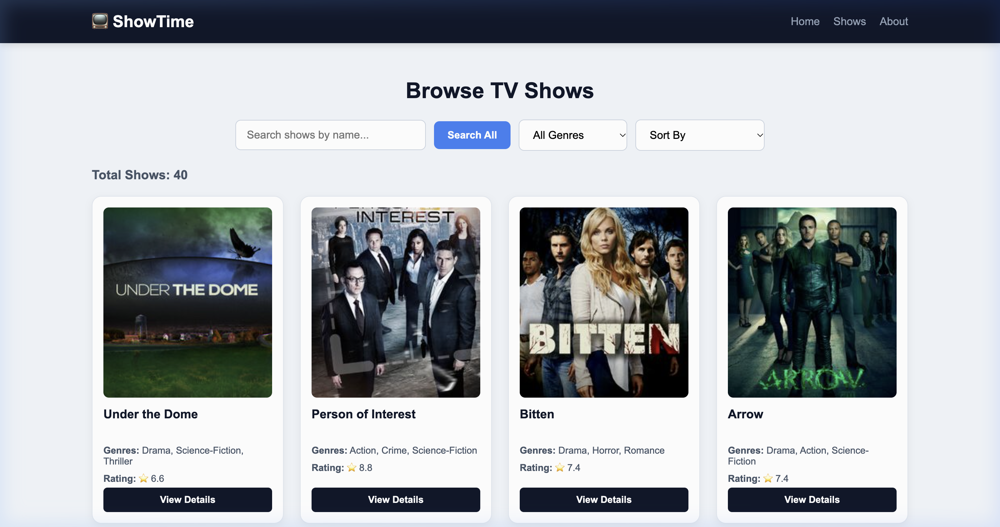
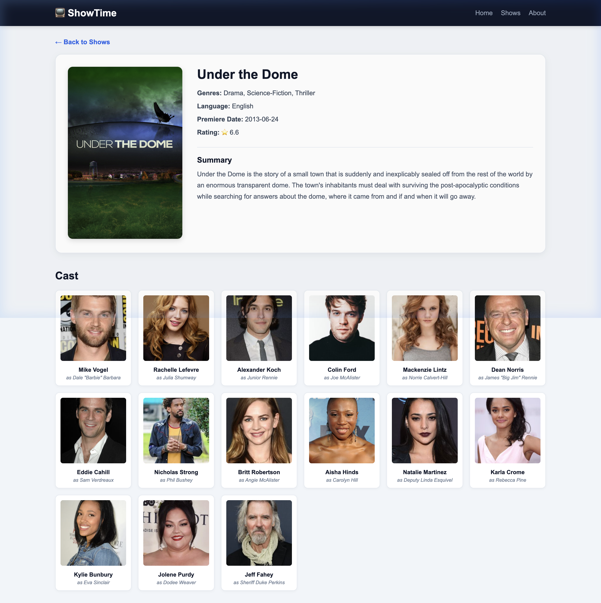

# Assignment 5 - ShowTime (PS6) - Web Assignment

## Project Information

- **PS Number:** PS6
- **Project Name:** ShowTime: TV show finder
- **Live Link:** https://ps6-showtime.vercel.app

## APIs Used

- TV shows list (first 40 shows): `https://api.tvmaze.com/shows?page=0`
- Show details: `https://api.tvmaze.com/shows/:id`
- Show cast members: `https://api.tvmaze.com/shows/:id/cast`

## Routes

- `/` - Home page with hero section and "Browse Shows" button
- `/shows` - Shows catalog page with search bar, genre filter, and show cards
- `/shows/:id` - Show detail page showing poster, summary, genres, rating, and cast list
- `/about` - About page explaining the application
- `*` - 404 Page Not Found with link back to Home

### Home Page


### Shows Page



### Show Details Page



## How to Run

1. Install dependencies:

```bash
npm install
```

2. Start development server:

```bash
npm run dev
```

3. Build for production:

```bash
npm run build
```

# web_assignment_5

# web_assignment-5

# Web_assignment_5

# Web_assignment_5

# assignment5

# assignment5
